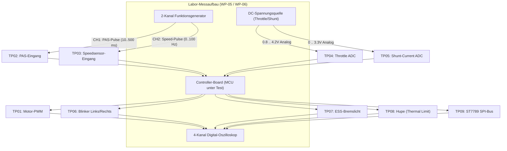

# Labor-Prüfplan & Oszilloskop-Messanweisung (WP-05 / WP-06)
## Metisa / Arduino Pedelec Controller (APC v1.43 Multi-Architecture HAL)

**Dokument-ID:** `METISA-LAB-WP05-WP06-REV1.0`  
**Geltungsbereich:** Stromlose Boardprüfung, I/O-Signalverifikation, Sensor-Timing, Licht-/Signalanlage und Safety-Failsafes  
**Geprüfte Architekturen:** Atmel AVR (ATmega328P, ATmega2560), STM32 (F401, F411, F446, G431, F103), Raspberry Pi RP2040 / RP2350, Espressif ESP32 (Classic, S3, S2, C3)  
**Relevante Normen:** DIN EN 15194 (EPAC Sicherheit), StVZO (§ 67 lichttechnische Einrichtungen, § 64a Schallzeichen), ECE-R 50 (Fahrtrichtungsanzeiger / ESS)

---

## 1. Sicherheitsanweisung & Prüfplatzzulassung (Gate G-1 / G-2)

> [!CAUTION]
> **STRIKTE TRENNUNG DER MOTORLEISTUNG:**  
> Bei allen Messungen nach diesem Prüfplan muss der Motor physisch vom Leistungsteil getrennt sein. Die FET-Brücke des Motorcontrollers darf während der Board- und I/O-Prüfung nicht mit der Hochvolt-Traktionsbatterie (> 36V/48V) verbunden sein. Die Versorgung des Controllers erfolgt ausschließlich über ein strombegrenztes Labornetzteil (max. 1.0 A @ 5.0 V bzw. 3.3 V).

### Sicherheits-Invarianten vor Testbeginn
1. **Kein undefinierter HIGH-Pegel am Motorausgang:** Während Power-on, Bootloader-Lauf, System-Reset und Brownout muss der Motorausgangspegel zwingend $V_{out} < 0.4\text{ V}$ (GND-Referenz) oder hochohmig mit passivem Pulldown ($\le 10\text{ k}\Omega$) sein.
2. **5V-Schutz bei 32-Bit-Plattformen:** Die historischen APC v1.43-Sensoren (PAS, Hallsensoren, Gasgriff) arbeiten typischerweise mit 5.0 V Betriebsspannung. An 32-Bit-MCUs (STM32, RP2040, ESP32) dürfen an den Analogeingängen (ADC) maximal 3.3 V anliegen. Für 5V-tolerante digitale Eingänge (STM32 FT-Pins) ist die Toleranz im Datenblatt zu verifizieren. Alle Analogeingänge erfordern einen $2:3$-Spannungsteiler oder eine OpAmp-Klemmung.

---

## 2. Erforderliche Laborausstattung

| Gerät | Mindestanforderung | Zweck |
| :--- | :--- | :--- |
| **Digital-Speicheroszilloskop (DSO)** | 4 Kanäle, $\ge 100\text{ MHz}$ Bandbreite, $\ge 1\text{ GSa/s}$, Segmentierter Speicher, Protokolldekoder (UART, SPI, I2C) | Erfassung von PWM-Jitter, ISR-Flanken, Lichtsignalfrequenzen und SPI-Bustiming |
| **Tastköpfe (Probes)** | 4× 10:1 passive Tastköpfe ($10\text{ M}\Omega$, $< 15\text{ pF}$), sauber abgeglichen (LF-Kompensation an 1 kHz Testpunkt) | Hochohmige Signalabgriffe |
| **2-Kanal Arbiträr-Signalgenerator** | 2 Kanäle, synchronisierbar, $0 .. 20\text{ MHz}$, $0 .. 5\text{ V}$ TTL/CMOS, einstellbarer Duty-Cycle und Phasenversatz | Simulation von PAS-Pedalsensor (Kanal 1) und Radgeschwindigkeitssensor (Kanal 2) |
| **Präzisions-Labornetzteil** | $0 .. 30\text{ V}$ / $0 .. 3\text{ A}$, Strombegrenzung auf $200\text{ mA}$ eingestellt, Restwelligkeit $< 5\text{ mV}_{RMS}$ | Sichere Logikversorgung |
| **Einstellbare DC-Quelle / Poti** | $0 .. 5.0\text{ V}$ bzw. $0 .. 3.3\text{ V}$ hochpräzise (Spindeltrimmer $10\text{ k}\Omega$) | Simulation von Gasgriff (Throttle) und Shunt-Strom (ACS712 / Hall-Current) |
| **Digitalmultimeter (DMM)** | True-RMS, $\ge 4\frac{1}{2}$ Stellen | DC-Pegel- und Referenzspannungsmessung |

---

## 3. Oszilloskop-Messpunkte-Matrix (Test Point Matrix TP01 bis TP10)



---

### TP01: Motor-PWM / Motorsteuer-Ausgang
- **Hardware-Pins:**
  - AVR Nano: Pin `D6` (OC0A Fast-PWM)
  - AVR Mega: Pin `D8` (OC4C)
  - STM32: Pin `PA8` / `PB6` (TIM1_CH1 / TIM4_CH1)
  - RP2040: Pin `GP16` (PWM Slice 0A)
  - ESP32: Pin `GPIO18` (LEDC Channel 0)
- **Sollwerte & Toleranzen:**
  - Frequenz: $32.0\text{ kHz} \pm 1.0\text{ kHz}$ (bei 32 kHz Fast-PWM) bzw. $490\text{ Hz} \pm 5\text{ Hz}$ (Standard-Arduino-PWM)
  - Tastgrad ($D$): $0.0\% .. 100.0\%$ entsprechend Digitalwert $0 .. 255$
  - Spannungspegel: LOW $< 0.4\text{ V}$, HIGH $\ge 3.0\text{ V}$ (3.3V-Logik) bzw. $\ge 4.5\text{ V}$ (5V-Logik)
- **Prüfschritte am Oszilloskop:**
  1. **Boot-/Reset-Test:** DSO auf Einzelflanke (Single Shot Trigger), Triggerpegel $0.8\text{ V}$ steigend, Zeitbasis $50\text{ ms/div}$. Board einschalten und Reset-Taster betätigen.  
     *Kriterium:* Kein einziger Glitch/Spike $> 0.5\text{ V}$ während Bootloader-Lauf und Watchdog-Initialisierung.
  2. **Regelkennlinie:** Gasgriff von Ruhelage ($0.8\text{ V}$) auf Vollgas ($3.8\text{ V}$) drehen (PAS aktiv simuliert).  
     *Kriterium:* Lineares Ansteigen des Tastgrads von $0\%$ auf $100\%$ ohne Phasensprünge oder Aussetzer.
  3. **Bremsen-Failsafe:** Bremskontakt betätigen (`SUPPORT_BRAKE`).  
     *Kriterium:* Tastgrad fällt innerhalb von $t_{react} \le 8.0\text{ ms}$ hart auf $0.0\%$ ab.

---

### TP02: PAS-Sensoreingang (Pedal Assist Sensor)
- **Hardware-Pins:**
  - AVR Nano: Pin `D2` (INT0)
  - AVR Mega: Pin `D21` (INT0)
  - STM32: Pin `PB0` / `PA0` (EXTI0)
  - RP2040: Pin `GP2` (GPIO IRQ)
  - ESP32: Pin `GPIO14` (GPIO ISR)
- **Signalcharakteristik Generator:**
  - Signalform: Rechteck, $50\%$ Duty-Cycle, $0 .. 3.3\text{ V}$ (bzw. $5.0\text{ V}$ mit Pegelwandler)
  - Frequenzbereich: $2\text{ Hz}$ (ca. 2.5 RPM bei 48 Magneten) bis $100\text{ Hz}$ (ca. 125 RPM)
- **Prüfschritte am Oszilloskop:**
  1. **Entprellungs- und Flankenfilterung:** Injizieren von Störspikes mit $t_{spike} = 1 .. 5\text{ ms}$ auf dem Signalgenerator.  
     *Kriterium:* Durch die `elapsed_time.h`-Validierung dürfen Spikes $< 10\text{ ms}$ keinen PAS-Interrupt-Trigger und keinen Anlauf des Motors auslösen.
  2. **Abschaltzeit nach Pedalierstopp (PAS-Timeout):** Generator von $20\text{ Hz}$ schlagartig auf $0\text{ Hz}$ stoppen. DSO auf Flankenabfall triggern.  
     *Kriterium:* Motor-PWM an TP01 muss nach exakt $t_{timeout} = 500\text{ ms} \pm 50\text{ ms}$ auf $0\%$ abschalten (DIN EN 15194 Anforderung: Motorstopp innerhalb von max. 2.0 s, Metisa-APC schaltet bereits nach $\le 0.5\text{ s}$ ab).

---

### TP03: Radgeschwindigkeits-Sensor (Speedsensor Reed / Hall)
- **Hardware-Pins:**
  - AVR Nano: Pin `D3` (INT1)
  - AVR Mega: Pin `D20` (INT1)
  - STM32: Pin `PB1` / `PA1` (EXTI1)
  - RP2040: Pin `GP3`
  - ESP32: Pin `GPIO13`
- **Signalcharakteristik Generator:**
  - Frequenz proportional zur Geschwindigkeit: $f = \frac{v\text{ [km/h]}}{3.6 \times \text{Umfang [m]}}$.  
    (Bei $2200\text{ mm}$ Reifenumfang: $25\text{ km/h} \approx 3.156\text{ Hz}$; $32\text{ km/h} \approx 4.04\text{ Hz}$; $99\text{ km/h} \approx 12.5\text{ Hz}$).
- **Prüfschritte am Oszilloskop:**
  1. **StVZO-Abregelrampe (Level 0 - StVZO-Modus):**
     - Generatorfrequenz kontinuierlich von $2.0\text{ Hz}$ ($15.8\text{ km/h}$) auf $4.0\text{ Hz}$ ($31.7\text{ km/h}$) hochfahren.
     - Beobachtung TP01 (Motor-PWM):  
       - Bei $v \le 22.0\text{ km/h}$ ($f \le 2.78\text{ Hz}$): Volle Leistung nach PAS/Gasgriff.  
       - Zwischen $22.0\text{ km/h}$ und $25.0\text{ km/h}$: Kontinuierliche lineare Leistungsabsenkung.  
       - Bei $v \ge 25.0\text{ km/h}$ ($f \ge 3.16\text{ Hz}$): Exakt $0.0\%$ PWM.
  2. **PIN-Freischaltung Level 1 (PIN: 1305):**  
     - Abschaltung erst bei exakt $v = 32.0\text{ km/h}$ ($f = 4.04\text{ Hz}$).
  3. **Master-PIN Freischaltung Level 2 (PIN: 210286 - Rennstrecke/Privatgelände):**  
     - Freigabe bis $v = 99.0\text{ km/h}$ ($f = 12.5\text{ Hz}$).
  4. **Key-Cycle Reset:** Nach Power-Cycle (Versorgungsspannung kurz trennen) muss das System zwingend wieder in Level 0 ($25.0\text{ km/h}$) starten.

---

### TP04: Gasgriff / Daumengas ADC (Throttle Input)
- **Hardware-Pins:**
  - AVR Nano: Pin `A7` (ADC7)
  - AVR Mega: Pin `A15` (ADC15)
  - STM32: Pin `PA5` (ADC1_IN5)
  - RP2040: Pin `GP26` (ADC0)
  - ESP32: Pin `GPIO36` (ADC1_CH0)
- **Sollbereiche:**
  - Ruhelage (Offset): $0.85\text{ V} .. 1.10\text{ V}$ (ADC-Wert ca. $180 .. 220$ bei 10-Bit)
  - Vollgas (Max): $3.60\text{ V} .. 4.20\text{ V}$ (ADC-Wert ca. $750 .. 860$)
  - Unterer Fehlerbereich (Kabelbruch): $V_{adc} < 0.60\text{ V}$
  - Oberer Fehlerbereich (Kurzschluss nach 5V): $V_{adc} > 4.50\text{ V}$
- **Prüfschritte am Oszilloskop:**
  1. **Drahtbruchsimulation:** Signalleitung über Schalter auf GND ziehen ($V < 0.5\text{ V}$).  
     *Kriterium:* Motorausgang an TP01 schaltet unverzüglich ($t < 20\text{ ms}$) auf $0.0\%$ ab. Fehlerspeicher im HMI setzt `ERR_THROTTLE`.
  2. **Kurzschlusssimulation:** Signalleitung auf VCC legen ($V > 4.6\text{ V}$).  
     *Kriterium:* Sofortige Notabschaltung; kein unkontrolliertes Durchgehen des Motors.

---

### TP05: Shunt-Stromsensor / Batterie-Strommessung ADC
- **Hardware-Pins:**
  - AVR Nano: Pin `A2`
  - STM32: Pin `PA2` (ADC1_IN2)
  - RP2040: Pin `GP28` (ADC2)
  - ESP32: Pin `GPIO32` (ADC1_CH4)
- **Prüfschritte am Oszilloskop:**
  1. Einspeisen einer synthetischen Gleichspannung entsprechend $0 .. 20\text{ A}$ Shunt-Signal.
  2. Überprüfen der dynamischen PID-Stromabregelung bei Erreichen des konfigurierten `curr_power_max`-Limits (z.B. $500\text{ W}$ bei $36\text{ V} \approx 13.9\text{ A}$).
  3. Bei Stufe 2 (Master-PIN `210286`): Überprüfen der erweiterten Grenze auf $1000\text{ W}$ ($27.8\text{ A}$).

---

### TP06: Fahrtrichtungsanzeiger / Blinker Links & Rechts
- **Hardware-Pins:**
  - STM32: `PA10` (Blinker Links), `PA11` (Blinker Rechts)
  - RP2040: `GP6` (Links), `GP7` (Rechts)
  - ESP32: `GPIO25` (Links), `GPIO26` (Rechts)
- **Sollwerte & ECE-R 50 Konformität:**
  - Blinkfrequenz: $f_{blink} = 1.50\text{ Hz} \pm 0.10\text{ Hz}$ ($T = 667\text{ ms} \pm 45\text{ ms}$)
  - Tastgrad ($D$): $50.0\% \pm 2.0\%$ ($t_{on} = 333\text{ ms} \pm 20\text{ ms}$, $t_{off} = 333\text{ ms} \pm 20\text{ ms}$)
  - Automatische Rückstellung: Nach $t_{cancel} = 20.0\text{ s} \pm 0.5\text{ s}$ Dauertaktung.
- **Prüfschritte am Oszilloskop:**
  1. DSO Kanal 1 an `PA10`, Kanal 2 an `PA11`. Zeitbasis $200\text{ ms/div}$.
  2. **Blinker Links:** Taster kurz betätigen. DSO erfasst Rechtecksignal mit exakt $1.5\text{ Hz}$ an CH1; CH2 bleibt strikt LOW.
  3. **Auto-Cancel:** Zeitbasis auf $2\text{ s/div}$ stellen. Blinken starten. Nach $20\text{ s}$ muss der Takt automatisch enden.
  4. **Warnblinkmodus:** Beide Kanäle gleichzeitig aktiv. Messung des Phasenversatzes $\Delta \phi$ zwischen CH1 und CH2: $\Delta t_{phase} < 2.0\text{ ms}$ (perfekt synchrone Flanken).

---

### TP07: Notbremslicht (ESS - Emergency Stop Signal)
- **Hardware-Pins:**
  - STM32: `PA9` (Bremslicht-Ausgang)
  - RP2040: `GP8`
  - ESP32: `GPIO19`
- **Sollwerte & ECE-R 50 / StVZO Konformität:**
  - Normalbremsung ($v \le 15\text{ km/h}$): Statisches Dauerlicht (HIGH $100\%$).
  - Notbremsung (ESS-Modus bei $v > 15\text{ km/h}$ und $\Delta v / \Delta t \le -3.0\text{ m/s}^2$):  
    Schnellblinkendes Warnsignal mit $f_{ess} = 3.50\text{ Hz} \pm 0.20\text{ Hz}$ ($T = 286\text{ ms} \pm 15\text{ ms}$, $t_{on} = t_{off} = 143\text{ ms}$).
- **Prüfschritte am Oszilloskop:**
  1. Generator auf $v = 10\text{ km/h}$ einstellen. Bremskontakt schließen.  
     *Kriterium:* DSO zeigt konstanten HIGH-Pegel ohne Takten.
  2. Generator auf $v = 25\text{ km/h}$ einstellen. Bremskontakt schließen und Generatorfrequenz abrupt absenken (Simulation Vollbremsung).  
     *Kriterium:* DSO zeigt sofortigen Wechsel in schnelles Rechtecksignal mit exakt $3.5\text{ Hz}$ ($286\text{ ms}$ Periode).
  3. Nach Stillstand ($v = 0\text{ km/h}$): Automatischer Rückfall auf statisches Bremslicht.

---

### TP08: Hupe (Horn Output) mit thermischem Schutzabschalter
- **Hardware-Pins:**
  - STM32: `PA8`
  - RP2040: `GP9`
  - ESP32: `GPIO23`
- **Sollwerte:**
  - Reaktionszeit bei Tasterdruck: $t_{on} < 5.0\text{ ms}$
  - Thermische Zwangstrennung bei Dauerdruck: $t_{cutoff} = 3.00\text{ s} \pm 0.10\text{ s}$
- **Prüfschritte am Oszilloskop:**
  1. DSO Kanal 1 an Hupentaster, Kanal 2 an Hupenausgang. Trigger auf CH1 steigende Flanke. Zeitbasis $500\text{ ms/div}$.
  2. Hupentaster dauerhaft gedrückt halten.  
     *Kriterium:* CH2 schaltet nach $t_{react} = 2.4\text{ ms}$ auf HIGH und fällt nach exakt $3.0\text{ s}$ automatisch auf LOW ab, obwohl CH1 weiterhin HIGH ist.
  3. Erst nach Loslassen und erneutem Drücken von CH1 darf CH2 wieder ansprechen.

---

### TP09: ST7789 SPI-Bus Signalintegrität
- **Hardware-Pins:**
  - SPI SCK, MOSI, CS (`PA4` / `GP17` / `GPIO5`), DC (`PB1` / `GP20` / `GPIO21`).
- **Prüfschritte am Oszilloskop:**
  1. Bandbreite auf $100\text{ MHz}$ voll öffnen, Zeitbasis $20\text{ ns/div}$.
  2. Messung der Taktfrequenz $f_{sck}$: $24\text{ MHz}$ (STM32), $31.25\text{ MHz}$ (RP2040), $40\text{ MHz}$ (ESP32).
  3. Messung der Signalflanken: Anstiegszeit $t_r \le 5.0\text{ ns}$, Abfallzeit $t_f \le 5.0\text{ ns}$.
  4. Überprüfung auf Überschwinger (Overshoot): $V_{max} \le VDD + 0.3\text{ V}$ ($< 3.6\text{ V}$), kein Unterschwinger $< -0.3\text{ V}$.

---

### TP10: Watchdog- & Brownout-Verhalten (Fault Injection)
- **Prüfschritte am Oszilloskop:**
  1. **Software-Hang Injection:** Gezielte Endlosschleife `while(1);` im Debug-Menü auslösen.
  2. **Watchdog-Auslösezeit:**  
     - AVR ATmega328P: $t_{wdt} = 2.048\text{ s} \pm 0.10\text{ s}$ (WDT Prescaler 2s)  
     - STM32 IWDG: $t_{wdt} = 1.50\text{ s} \pm 0.10\text{ s}$  
     - RP2040 Watchdog: $t_{wdt} = 2.00\text{ s} \pm 0.10\text{ s}$  
     - ESP32 Task WDT: $t_{wdt} = 2.00\text{ s} \pm 0.10\text{ s}$
  3. **Signalzustand während WDT-Reset:**  
     *Kriterium:* Während des Watchdog-Resets und des anschließenden Neustarts bleiben TP01 (Motor) und alle Lichtausgänge (TP06, TP07, TP08) strikt inaktiv ($0.0\text{ V}$). Der Motor darf unter keinen Umständen anlaufen.

---

## 4. Labor-Prüfprotokoll & Abnahmeformular (Template)

```text
================================================================================
METISA APC v1.43 - HARDWARE-LABOR-ABNAHMEPROTOKOLL (WP-05 / WP-06)
================================================================================
Prüfdatum:        _____________________      Prüfer:          _____________________
MCU-Board:        _____________________      Board-Revision:  _____________________
Seriennummer:     _____________________      Firmware-Git:    _____________________
Oszilloskop:      _____________________      Signalgenerator: _____________________
--------------------------------------------------------------------------------
Messpunkt | Parameter                 | Sollwert             | Istwert | Status
--------------------------------------------------------------------------------
TP01      | Boot/Reset Glitch         | < 0.4V (0 ns Spike)  | _____ V | [ ] PASS [ ] FAIL
TP01      | Motor-PWM Frequenz        | 32 kHz / 490 Hz      | _____ Hz| [ ] PASS [ ] FAIL
TP01      | Notabschaltung bei Bremse | < 10.0 ms            | _____ ms| [ ] PASS [ ] FAIL
TP02      | PAS Prellfilter (<10 ms)  | Keine Fehlauslösung  | _______ | [ ] PASS [ ] FAIL
TP02      | PAS Abschalt-Timeout      | 500 ms ± 50 ms       | _____ ms| [ ] PASS [ ] FAIL
TP03      | 25 km/h Abregelung (L0)   | 0% PWM @ 25.0 km/h   | _____   | [ ] PASS [ ] FAIL
TP03      | 32 km/h Abregelung (L1)   | 0% PWM @ 32.0 km/h   | _____   | [ ] PASS [ ] FAIL
TP03      | 99 km/h Abregelung (L2)   | 0% PWM @ 99.0 km/h   | _____   | [ ] PASS [ ] FAIL
TP03      | Key-Cycle Reset auf L0    | Automatischer Reset  | _______ | [ ] PASS [ ] FAIL
TP04      | Throttle Kabelbruch (<0.6V)| Sofortiges Motor-Aus| _______ | [ ] PASS [ ] FAIL
TP04      | Throttle Kurzschluss(>4.5V)| Sofortiges Motor-Aus| _______ | [ ] PASS [ ] FAIL
TP06      | Blinker-Frequenz          | 1.50 Hz ± 0.10 Hz    | _____ Hz| [ ] PASS [ ] FAIL
TP06      | Blinker Auto-Cancel       | 20.0 s ± 0.5 s       | _____ s | [ ] PASS [ ] FAIL
TP06      | Warnblinker-Synchronität  | Delta-t < 2.0 ms     | _____ ms| [ ] PASS [ ] FAIL
TP07      | ESS-Notbremsblinken       | 3.50 Hz ± 0.20 Hz    | _____ Hz| [ ] PASS [ ] FAIL
TP08      | Hupen-Dauerabschaltung    | 3.00 s ± 0.10 s      | _____ s | [ ] PASS [ ] FAIL
TP09      | SPI Taktflanke tr / tf    | < 5.0 ns             | _____ ns| [ ] PASS [ ] FAIL
TP10      | WDT-Auslösezeit           | 1.5 s .. 2.1 s       | _____ s | [ ] PASS [ ] FAIL
TP10      | Motorpegel bei WDT-Reset  | 0.0V (Fail-Safe)     | _____ V | [ ] PASS [ ] FAIL
--------------------------------------------------------------------------------
GESAMTBEWERTUNG: [ ] BESTANDEN (WP-06 Freigabe)     [ ] NICHT BESTANDEN
Unterschrift Prüfingenieur: _____________________________________________
================================================================================
```
